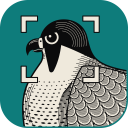
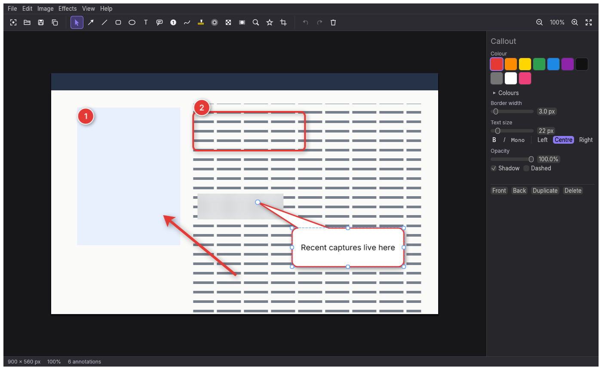
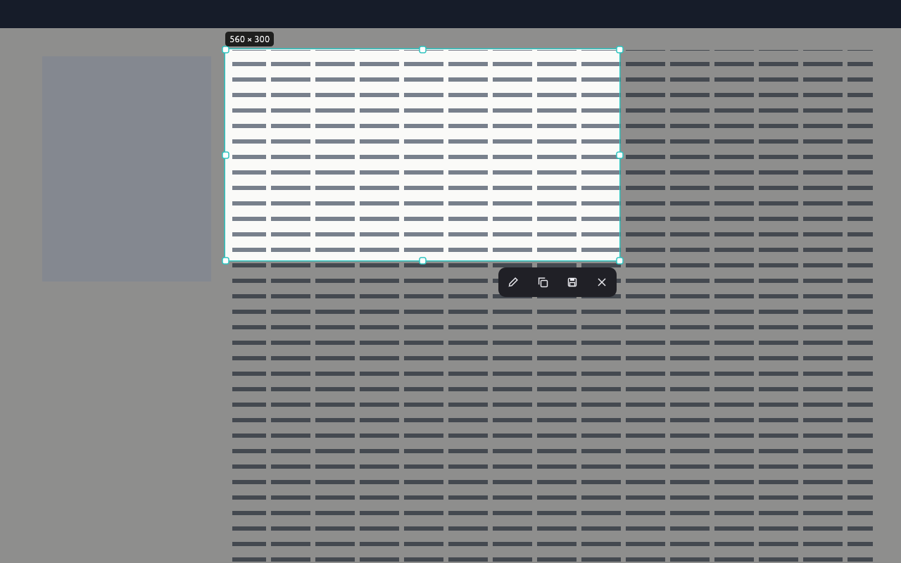
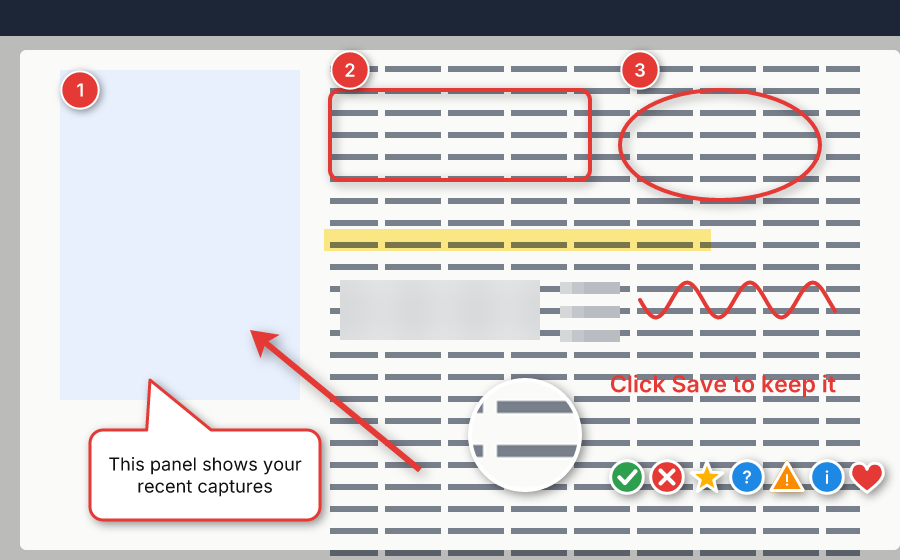

# ScreenGrabCraft

 

**An open-source screen capture and annotation suite, written from scratch in Rust.**

ScreenGrabCraft does what people use Snagit for: press Print Screen, drag out an area (or click a
window), and mark it up with arrows, callouts, numbered steps, blur and highlights before sharing
it. It is two programs:

- **ScreenGrabCraft**, the capture service. It lives in the system tray (the menu bar on macOS)
  and runs as a persistent per-user service: it starts when you sign in and is started again if
  it ever stops. It answers global shortcuts and the tray menu.
- **ScreenGrabCraft Editor**, where captures are marked up. It also runs in a browser.

Both are native, GPU-drawn programs (no Electron, no web view), with a command-line program
beside them for scripts and agents.

> **Status: early alpha (0.1).** Capturing, the editor and the packaging are in place and tested;
> see [ROADMAP.md](ROADMAP.md) for what's next and what has only been checked by the build machines.

| | |
|---|---|
|  |  |



## Capturing

| Shortcut (Windows, Linux) | macOS | |
|---|---|---|
| Print Screen | Ctrl+Shift+C | **Region**: drag out an area, or click a window; adjust it with its handles; Enter keeps it |
| Alt+Print Screen | Ctrl+Shift+W | **Window**: click a window |
| Ctrl+Print Screen | Ctrl+Shift+F | **Full screen**: the monitor under the pointer |
| Ctrl+Shift+Print Screen | — | **All screens** in one picture |
| Ctrl+Alt+Print Screen | Ctrl+Shift+S | **Scrolling**: scroll a long page while ScreenGrabCraft joins it into one picture |
| Alt+Shift+Print Screen | Ctrl+Shift+G | **Record GIF** of an area (press again, or click the tray icon, to stop) |
| Shift+Print Screen | Ctrl+Shift+R | **Repeat** the last area |

Every shortcut can be changed (or switched off) in the service's settings, and the tray menu has
every capture, a delayed capture (3, 5 or 10 s), the editor and the captures folder. While choosing
an area the screen is frozen as it was when the key was pressed (open menus and tooltips included),
with a magnifier that shows the pixels, coordinates and colour under the pointer, crosshairs, the
windows under the pointer to click, and the area's size. Arrows nudge the area; Shift+arrows resize it.

After a capture ScreenGrabCraft does what its settings say: open it in the editor, copy it to the
clipboard, and/or save it in **Pictures/ScreenGrabCraft** (PNG, JPEG, WebP, BMP or PDF, with a file
name pattern of your own). With the capture bar on, Edit, Copy and Save are a click away.

## Editing

Annotations stay editable (move them, resize them, restyle them) until you flatten or export:

- **Arrow** (one or two heads, any thickness), **line**, **rectangle** (rounded corners),
  **ellipse**, **pen** and **highlighter**; Shift draws at 45° and makes squares and circles.
- **Text** and **callouts** (speech balloons with a tail you drag), in Inter or JetBrains Mono,
  bold, italic, left, centred or right.
- **Step** numbers that count themselves, and **stamps** (check, cross, star, question, warning,
  information, heart).
- **Blur**, **pixelate**, **spotlight** (darken everything else) and **magnify** (a lens).
- Colours (a palette that reads well for people who see red and green alike, and any colour),
  thickness, opacity, shadows, dashes.
- **Crop**, **resize**, canvas size, rotate, flip, trim borders.
- **Effects**: border, drop shadow, torn edge, round corners, greyscale, invert, brightness and
  contrast.
- Undo and redo for everything, copy and paste (a pasted picture lands as an editable object),
  drag and drop, zoom and pan, the strip of recent captures.
- Save as a **`.sgcraft` project** (JSON; the annotations stay editable) or export PNG, JPEG,
  WebP, BMP, GIF or PDF.

The editor's keyboard shortcuts are under Help › Keyboard Shortcuts.

## The command line

```
screengrabcraft-cli capture --all -o desktop.png
screengrabcraft-cli capture --window Notepad --clipboard
screengrabcraft-cli run shot.png --cmd 'object.add={"object":{"type":"arrow","from":{"x":20,"y":20},"to":{"x":200,"y":120}}}' --cmd 'effect.shadow' -o shot.sgcraft
screengrabcraft-cli render shot.sgcraft -o shot.png
screengrabcraft-cli commands
screengrabcraft-cli service status
```

The capture service takes requests too, which is how a capture is bound to a key on a Wayland
desktop (where programs can't take global shortcuts): `screengrabcraft --capture region`,
`--capture window|screen|all|repeat|scrolling|gif`, `--delay 5`, `--settings`, `--quit`.

## Platforms

| | |
|---|---|
| **Desktop** | Windows 10/11 (x64, x86, ARM64), macOS 11+ (Apple silicon and Intel), Linux (x86_64, aarch64; X11 and Wayland), FreeBSD (x86_64) |
| **Web** | the editor, in any modern browser (WebGPU, or WebGL2) |

How the service stays running everywhere:

| | Starts at sign-in | Restarted if it stops |
|---|---|---|
| Windows | the installer's `Run` entry (or your own, for the portable zip); switch it off in the service's settings or Task Manager › Startup apps | its own supervisor (`--background`) |
| macOS | a LaunchAgent the app registers on its first start from Applications | launchd (`KeepAlive`) |
| Linux, FreeBSD | the packages' XDG autostart entry (or your own); a systemd user unit is included as the alternative | its own supervisor, or systemd |

Screen capture goes through GDI on Windows, Core Graphics on macOS (allow ScreenGrabCraft under
Privacy & Security › Screen Recording), the X11 protocol on X11 and the desktop's screenshot portal
on Wayland. The tray uses the StatusNotifierItem protocol on Linux and the BSDs (KDE Plasma, Xfce,
Cinnamon and MATE show it; GNOME needs the AppIndicator extension).

## Installing

Releases are on the [Releases page](https://github.com/billsecond/screengrabcraft/releases) with
their checksums: an MSI and a portable zip for Windows, a disk image for macOS, AppImage, `.deb`,
`.rpm`, Flatpak and tarballs for Linux, a FreeBSD tarball and the web build. The builds are not
signed yet, so Windows and macOS ask before running them. See [docs/releasing.md](docs/releasing.md).

## Building

```
git clone https://github.com/billsecond/screengrabcraft
cd screengrabcraft
cargo run --release -p screengrabcraft          # the capture service
cargo run --release -p screengrabcraft-editor   # the editor
cargo xtask ci                                  # the checks every change must pass
```

Linux needs `libxkbcommon-dev libwayland-dev` to build; everything else (X11, D-Bus, the portal,
the tray) is spoken in Rust. The web build: `cd apps/screengrabcraft-web && trunk serve`.

## Privacy

Captures never leave your computer unless you send them somewhere. ScreenGrabCraft has no network
code at all: no accounts, no telemetry, no update checks. See [PRIVACY.md](PRIVACY.md).

## Licence

MIT OR Apache-2.0, at your option. The bundled fonts (Inter, JetBrains Mono) are under the SIL Open
Font Licence. Every asset is listed in [ATTRIBUTION.md](ATTRIBUTION.md); ScreenGrabCraft contains no
other vendor's icons or artwork, and is not affiliated with TechSmith or Snagit.
