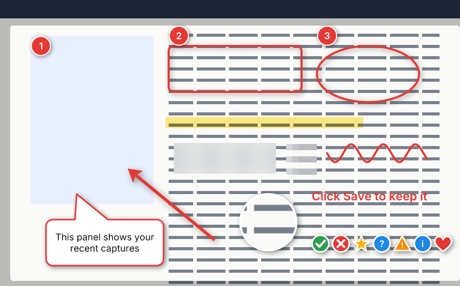

# ScreenGrabCraft

 

**An open-source screen capture and annotation suite, written from scratch in Rust.**

ScreenGrabCraft does what people use a screen capture tool for: press Print Screen, drag out an area (or click a
window), and mark it up with arrows, callouts, numbered steps, blur and highlights before sharing
it. It is two programs:

- **ScreenGrabCraft**, the capture service. It lives in the system tray (the menu bar on macOS)
  and runs as a persistent per-user service: it starts when you sign in and is started again if
  it ever stops. It answers global shortcuts and the tray menu.
- **ScreenGrabCraft Image Editor**, where screenshots and pictures are marked up (it also runs in
  a browser), and the **Video Editor**, the same program in a window of its own, where recordings
  are cut and edited. Each one's Recent strip lists its own: pictures in one, recordings in the
  other.

Both are native, GPU-drawn programs (no Electron, no web view), with a command-line program
beside them for scripts and agents.

> **Status: early alpha (0.1).** Capturing, the editor and the packaging are in place and tested;
> see [ROADMAP.md](ROADMAP.md) for what's next and what has only been checked by the build machines.


| Capture | Edit a video |
|---|---|
|  |  |

These are ScreenGrabCraft's own windows, running on Windows, each put on a made-up desktop. The
program being captured and edited in them is made up, and so are its customers and the person on
the camera (`cargo run -p screengrabcraft-ui --example shots -- docs/images dark live` opens each
window for a few seconds and keeps a picture of it, and of nothing else on the screen).

## Capturing

| Shortcut (Windows, Linux) | macOS | |
|---|---|---|
| Print Screen | Ctrl+Shift+C | **Region**: drag out an area, or click a window; adjust it with its handles; Enter keeps it |
| — (set one in Settings) | — | **Region, adjust first**: drag out an area, or start from the last one, and adjust it with its handles until Enter (or a button of the bar) takes it |
| Alt+Print Screen | Ctrl+Shift+W | **Window**: click a window |
| Ctrl+Print Screen | Ctrl+Shift+F | **Full screen**: the monitor under the pointer |
| — (set one in Settings; Ctrl+Shift+Print Screen is Windows' own) | — | **All screens** in one picture |
| Alt+Shift+Print Screen | Ctrl+Shift+S | **Scrolling**: scroll a long page while ScreenGrabCraft joins it into one picture |
| Ctrl+Alt+Print Screen | Ctrl+Shift+G | **Record GIF** of an area (press again, or click the tray icon, to stop) |
| Ctrl+Alt+Shift+Print Screen | Ctrl+Shift+V | **Record Video**: a small MP4 of an area, with the computer's sound (press again to stop) |
| — (set one in Settings) | Ctrl+Shift+P | **Video Production**: opens the Recorder; the screen, the camera, the microphone and the computer's sound, each on a track of its own, to edit |
| Shift+Print Screen | Ctrl+Shift+R | **Repeat** the last area |
| — (set one in Settings) | — | **Grab Text**: drag out an area (or click a window) and its text goes on the clipboard (Windows) |

Every shortcut can be changed (or switched off) in the service's settings, and the tray menu has
every capture, a delayed capture (3, 5 or 10 s), the editor and the captures folder. While choosing
an area the screen is frozen as it was when the key was pressed (open menus and tooltips included),
with a magnifier that shows the pixels, coordinates and colour under the pointer, crosshairs, the
windows under the pointer to click, and the area's size. Arrows nudge the area; Shift+arrows resize it.

As soon as you've chosen the area ScreenGrabCraft does its default: copy the capture to the
clipboard, open it in the editor, and save it in **Pictures/ScreenGrabCraft** (PNG, JPEG, WebP, BMP
or PDF, with a file name pattern of your own). The default is yours to change in the service's
settings. Turn the capture bar on to stop first, adjust the area, and pick Copy & Edit, Edit, Copy
or Save, for every capture; or use **Capture Region, Adjust First** (tray menu, or a shortcut of your own)
for just the captures you want to fine-tune. An open editor is hidden while you capture, which you can turn
off too (the video editor never is: it stays as you left it).

**While you record**, you can still take pictures: Capture Region, Window, Full Screen, All Screens
or Repeat, by their shortcuts or the recording's tray menu (Take a Screenshot). The recording goes
on; on Windows the screen frozen to choose the area, and what's said once it's kept, stay out of
the video. The picture is saved and copied as usual, and opens in the editor once the recording
stops, so nothing comes up over the screen being recorded.

On Windows the editor is kept ready in the background (Settings, After a capture): it starts a
little after the capture service, and closing its window hides it, so a capture opens in it at
once instead of waiting for Windows to start it. The editor opens where you left it: the same
place and monitor, the same size, maximized or not.

A GIF recording runs at 30 frames a second unless you set it lower, is always saved, and opens in
the editor like any capture, with a **Play** button under the picture. Any GIF you open there has one. What you draw goes on a still of the first frame,
not on the animation, and the GIF file itself is never changed.

**Videos** are MP4 files with AV1 pictures and Opus sound: royalty-free, written in Rust, and
small (a minute of a screen with some typing is a few megabytes). Windows 11, macOS 14 and every
current browser play them; on Windows 10 the free AV1 Video Extension from the Microsoft Store
adds AV1. **Record Video** makes the MP4 as soon as you stop (no larger than 1920 × 1080 unless
you choose the full size). **Video Production** (the tray menu's video section, the Capture page,
or its shortcut) opens the **Recorder**. Choose the area: a **region** you drag out, a **window**
you click (where it was then; it isn't followed if it moves), one **full screen**, **all screens**
in one video (made no larger than 3840 × 2160), or a **fixed size** placed with a click: the usual
monitor and video sizes, landscape, portrait and square, as many as fit on your monitors, or your
own. Turn each input on or off: the screen,
the camera, the microphone (with a level meter once you turn it on or press Test) and the
computer's sound. With the screen off the camera's picture is the video. Press the red **Record**;
the Recorder remembers every choice. The recording file (`.sgvideo`) has a track for each source
and opens in the video editor, where you cut and edit it, then Export Video makes the MP4 beside it. The
computer's sound can be recorded on Windows; the camera on Windows and macOS. Record Video's
sources are in Settings › Recording.

On Windows a Video Production recording also keeps **the shortcuts you press** while it records,
so the video editor can show them as keys on the video: only a key pressed with Ctrl, Alt or the
Windows key, and keys that don't type (Enter, Esc, Tab, Backspace, Delete, the arrows, Home, End,
Page Up and Down, F1 to F24). **Letters, digits, symbols and spaces you type are never kept**, nor
anything typed with AltGr, so a password typed while recording isn't in the recording. The keys
are only watched while recording, kept in the recording file and nowhere else, and never logged.
Settings › Recording turns it off.


## Editing a video

Recordings open in the **video editor**: a window of its own beside the picture editor, with its
own taskbar button and the same look (the tray menu, the Start menu and Settings open it too).
Pictures you take while you edit a video open in the picture editor, so the video stays as it
is; a picture opened in the video editor goes to the picture editor, and a recording opened in
the picture editor to the video editor. Its timeline has a row for each track:

- **Play** (Space), click or drag on the ruler to move the playhead, arrows step a frame. The
  full-screen button is beside the play buttons (F11 or F; Esc comes back).
- **Choose a stretch** with the two handles either side of the playhead on the ruler: they ride
  along with it until you drag one out. With a stretch chosen, Play plays just that: from the
  playhead when it's in it, else from the stretch's start, stopping at its end. Dragging across
  empty rows chooses one too, Ctrl+A chooses everything, Esc lets go. **Delete** (or Ctrl+X) takes
  the stretch out of every track, keeping them in step.
- **Right-click a track** to split that track alone, take the chosen stretch out of it alone
  (leaving silence, or no picture, so everything stays in time), choose the clip's stretch,
  delete the clip, or hide or mute the track. **Right-click the ruler** for every track at once:
  split them all, cut or remove the chosen stretch, choose from there to the end or the start,
  add text there, play, zoom.
- Click a clip to select it: Delete removes just that clip (silence, or no camera, there). Drag a
  clip's ends to trim it, or the clip to slide it along its track.
- **S** splits at the playhead: the selected clip's track, or every track.
- **Speed**: with a stretch chosen or a clip selected, the panel at the right (or Edit, or the
  ruler's right button) plays it from a quarter as fast to eight times as fast, on every track so
  they stay together; what follows moves up to follow on. Voices keep their pitch, and a clip
  that isn't as recorded says its speed on the timeline.
- **J, K and L**: L plays on, K pauses, J plays backwards; press J or L again to play that way
  2, 4 or 8 times as fast (without sound: only playing on as recorded is heard). **Play
  backwards**: a clip's right button (or Play backwards in its panel) plays it from its end to
  its start, the picture and the sound turned round, with the clips grouped with it.
- **Hold a frame**: H (or Edit, or the ruler's right button) holds the picture at the playhead
  still for a while (2 s; the menus offer 1 to 5): every track waits, the sound is silent
  meanwhile, and what follows moves along. Its panel holds it longer or shorter (or drag its end),
  or takes the hold out again.
- **Fades and noise**: click a sound clip and its panel fades its sound in at its start and out at
  its end, and takes its track's **background noise** out (a fan, a hum, hiss: learnt from the
  track itself, on this computer; voices stay). The track's right button turns the noise off and
  on too.
- **Groups, locks and colours**: a clip's right button groups it with the other tracks' clips over
  the same time (they then move together) and gives it a colour. **Shift-drag** a clip to push
  every later clip of its track along with it. The padlock in a track's header **locks** it (its
  clips stay as they are; cuts of the whole video still keep it in time), and **S** plays a sound
  track alone.
- **Volume line and levels**: double-click a sound clip's wave (or use the track's right button) to
  put a point of its volume line there, and drag points up and down or along: the sound goes
  straight from one to the next, and the points stay with the sound through every edit. The Sound
  Mix section of the panel **evens out the levels** (each sound track's volume set so they're about
  as loud, measured on this computer) and **lowers the rest under the voice**: the computer's
  sound, music and media go down while the microphone is heard, and back up after.
- **Markers**: M (or Edit, or the ruler's right button) marks the moment at the playhead with a
  flag on the ruler. The Markers section of the panel names them, goes to them and deletes them;
  they move with cuts and speed changes, and Export Video makes them the MP4's chapters, which
  video players list.
- **Export more than the video**: with a stretch chosen, Export Video can make **just that
  stretch** (its captions and chapters with it). File › **Export Sound** makes just the sound, as
  heard: a WAV, or a smaller M4A (AAC, made by Windows' own encoder, so on Windows only). File ›
  **Save the Frame as a Picture** (Ctrl+Shift+S, or the ruler's right button) saves the picture at
  the playhead, at the recording's own size, in the captures folder and opens it in the picture
  editor.
- **A watermark**: Export Video's window puts words, or a picture from the Media Bin, on every
  frame, in the corner you choose, as see-through and as large as you like. The preview shows it
  too, and it stays with the edits.
- **Subtitles brought in**: File › **Import Subtitles** reads a SubRip (`.srt`) or WebVTT
  (`.vtt`) file timed on the video as it is now and makes it the video's captions; from then on
  each line follows the track it's on, like the captions written down here.
- **The pointer**, in a recording that has it: the Pointer section of the panel at the right shows
  it larger or smoother, rings its clicks and lets them be heard (a click made in code), and puts a
  yellow highlight under it, a spotlight round it (the rest dimmed) or a lens on it that shows
  what's round it twice as large.
- **The camera's background taken away**, so the screen shows round you (the camera's panel,
  Background): **Remove a colour** for a green screen (choose the colour and how far from it
  still goes; its green glow on you is taken out), or **Remove it** with no green screen: the
  background model (the one Remove Background uses, on this computer) looks at four of the
  camera's pictures and learns what the room behind you looks like, then every picture keeps
  what differs from it. Keep the camera still; Learn It Again if the light changed. What it
  learnt is kept in the recording file.
- **Keys pressed**: in a recording that kept the shortcuts pressed (see above), the Keys Pressed
  section of the panel shows each as keys on the video for a moment after it's pressed, where the
  edits put that moment: at the bottom (above the captions), the top or a corner, any size, light
  or dark keys.
- **Zoom and pan**: the Library's Zoom and Pan section zooms into part of the screen and back. While
  a zoom is chosen the picture shows all of the screen and the zoom's frame: drag the frame where it
  should zoom and its corners to zoom closer. It goes in and out smoothly or at once, and a zoom that
  starts where another ends pans straight from one to the other. Only the screen and the pointer
  are zoomed; the camera, titles and captions stay where they are.
- **Transitions between clips**: where two clips of a track meet, one can turn into the other (a
  cross-fade, through black, a wipe four ways, a push or a circle), from the clip's panel, its
  right button, or the Library's Between Clips section dropped on the cut. It plays across the
  cut, 0.5 to 3 s; where sound clips meet it's a cross-fade of their sound.
- **Turned and framed**: an item's panel turns it (Turn); a picture's or a video's crops its
  sides, puts a border of any colour round it, rounds its corners and gives it a soft shadow
  (Frame). A screen or camera clip's panel makes it lighter or darker, changes its contrast and
  colour (down to grey), and crops its edges (what's left fills the picture, its shape kept).
- **Looks, masks and blends**: a screen or camera clip's panel gives it a ready-made look (warm,
  cool, vivid, faded, dramatic, black and white, sepia, night) or a tint of any colour. An item's
  panel (Mask and Blend) shows it only inside a shape (a rectangle, rounded rectangle, oval,
  diamond, star or heart), or cuts the shape out of it, and lays it on what's under it as
  multiply, screen, overlay, darken or lighten.
- **Screen frame and devices**: the side panel's Screen Frame makes the recording's screen smaller
  on a background colour, rounds its corners and gives it a border and a shadow, and can draw a
  plain laptop, phone or browser window round it. A picture or a video on a layer can have one
  round it too (its panel, Device round it). The devices are simple shapes drawn in code.
- **Keyframes**: an item's panel adds a keyframe at the playhead (Motion); move the playhead on and
  move, resize or fade the item (on the picture or in the panel) and it goes there smoothly. A
  zoom's keyframes pan it along. The timeline shows each as a diamond on the item.
- **Text** (T) puts words on the video at the playhead, ready to type over. The **Library** at
  the left has titles, lower thirds, news graphics, callouts, arrows, a countdown, an end card, a
  checklist, a click and a **blur** that hides what's under it (a password, an address), and
  transitions, to drag onto the timeline; and a bin for your own pictures, videos and sound. Each
  card shows the item as it will be on the video, where and as large; hold the pointer on one and
  it plays, larger.
- Each track and layer has a switch to **hide or mute** it, and arrows to **move it up or down**
  (a layer higher up is in front); **double-click its name to rename it** (or use the right
  button). Each sound track has a volume slider; the camera's corner, size and shape (square,
  rounded, circle) are on the right.
- **Transcript** (the tool bar, or View) opens a pane at the right with everything said, line by
  line: when, who and what. Words from the microphone are **You**, from the computer's sound
  **Others**, and from a sound or video you added, its layer's name; rename any of them (the pencil,
  or a double click) and the name is the track's or the layer's, in the transcript, on the
  timeline and in Export Transcript. A click on a line takes the playhead there; while the video
  plays, the line playing is marked and kept in view. Copy puts the whole transcript on the
  clipboard. **Put a line right**: double-click it to change its words (and split it at the
  cursor); its right button splits it, joins it to the speaker's next line, moves its start or end
  to the playhead, or deletes it. The lines put right are what the picture, Export Video and the
  subtitles show; All Captions as Heard takes them back. **Cut words out of the video**: a line's
  right button, Cut Words from the Video, shows its words: click those to take out and press
  Delete, and where they're said goes from every track. **Take Out Filler Words** (in the pane,
  or Edit) cuts every um, uh and er the transcript has. Each word's time is worked out from its
  line's by its length, so check the cut by playing it (undo puts it back).
- Undo and redo everything. The edits are saved into the recording file a moment after each
  change (the recording itself is never changed), and File › Revert to Recording brings every
  track back whole.
- **Captions**: after a Video Production recording, what you said (the microphone, "You") and
  what the others said (the computer's sound, "Others") is written down on this computer, in
  the background: one thread at the lowest priority, never while recording, about a twelfth of
  the recording's length (Whisper base, English; nothing is sent anywhere). They appear on their
  own row under the tracks and follow your edits. **Show** puts them on the picture, **In video**
  burns them into the MP4, and an `.srt` and a `.txt` are saved beside the recording (and beside
  each MP4 made, as it was edited). When you use speakers rather than headphones, the others
  heard again by your microphone aren't written down twice. Turn them off with Captions in the
  Recorder; File › Make Captions makes them for a recording that has none.

## Editing

Annotations stay editable (move them, resize them, restyle them) until you flatten or export:



- The tool bar has **Favorites**, **Arrow**, **Text**, **Callout**, **Shape**, **Stamp**,
  **Fill** and **Move** in the middle, then every other tool, each with its own full-size button
  and its name under it (a narrow window gives the tools a row of their own; View › Tool Names
  turns the names off). Every tool keeps its key.
- **Quick Styles**: ready-made looks for each tool in a theme of four colours (Bold, Soft, Vivid,
  Mono), drawn as they will look. A click sets the tool's look and changes the selected
  annotations to it; the star on a look keeps it under **Favorites**, with the favourites of every
  tool, and a look made by hand can be kept too. See [the editor's tools](docs/editor-tools.md).
- **Grab Text** (Image menu, the right-click menu, Ctrl+Shift+T): the text in the picture, or in the
  area selected, read on this computer by Windows' own text reader and shown to copy (put anything
  right first). On macOS and Linux it isn't there yet.
- **Eyedropper** in every colour menu: pick any colour from the picture. Over the picture the
  eyedropper and the Fill tool's pail are the pointer, their tip on the spot they act on.
- **Selection** (Q): select part of the picture itself to move, copy, cut, delete or crop to.
  **Flatten** the selected annotations or all of them; a **right-click menu** on the picture has
  these and the rest. Copy with annotations selected copies just them.
- **Arrow** (one or two heads, any thickness), **line**, **shape** (a rectangle, rounded or not,
  or an ellipse) and **pen**; Shift draws at 45° and makes squares and circles.
- **Highlighter** (H): drag a box over what should stand out; it's tinted as under a marker
  (dark stays dark), and resized by its handles or moved like any shape.
- **Hand** (D): drag the picture round in the window. Space held down, or the middle button,
  does the same with any tool.
- **Text** and **callouts** in five forms (a rounded box, a box, an oval, a cloud and an arrow
  with the text in it) with a tail set to point down left, down right, left, right, up or down,
  and dragged anywhere; in PatroneOS Sans or PatroneOS Mono, bold, italic, left, centred or right.
  Text overlays: an outline round the letters, a shadow, a filled or see-through box behind
  them, and big titles, each a quick style of the Text tool.
- **Step** numbers that count themselves, and **stamps** (check, cross, star, question, warning,
  information, heart).
- **Blur**, **pixelate**, **spotlight** (darken everything else) and **magnify** (a lens).
- Colours (a palette that reads well for people who see red and green alike, and any colour),
  thickness, opacity, shadows, dashes.
- **Fill** (F): click the picture to fill an area of one colour (a tolerance takes in colours
  close to it; none makes it see-through), or click a box, ellipse, callout or text box to fill it.
- **Crop**, **resize**, canvas size, rotate, flip, trim borders.
- **Cut Out** (U): drag across the picture over what to take out (columns, or rows) and the rest
  is joined, straight or with a saw or a wave and a thin see-through gap. Annotations past the strip
  move with the picture. An area chosen with the Selection tool can be cut out from its right-click
  menu too.
- **Properties and Effects, docked at the right**: Properties (the quick styles and the tool
  properties) over Effects (border, drop shadow, torn edge, round corners, brightness and
  contrast, each opened with its settings and Apply; greyscale and invert under Colours). Drag
  the panes' left edge to make them wider, and the bar between them to give either more room
  (a double click puts it back). The Effects menu has them too.
- Everything stays on the picture: drawing, moving and resizing stop at its edge.
- Whatever drawing tool is chosen, a click on an annotation selects it and a drag moves it (the
  pen draws over things); its handles take hold even when the press is a little off.
- Rectangles, ellipses and callouts have a **fill** colour (none, the palette, or any colour).
- Undo and redo for everything, even after the editor is closed and the capture opened again
  (the last 30 steps are kept in its side file), copy and paste (a pasted picture lands as an editable object),
  drag and drop, zoom and pan, the strip of recent captures.
- Save as a **`.sgcraft` project** (JSON; the annotations stay editable) or export PNG, JPEG,
  WebP, BMP, GIF or PDF.

The editor's keyboard shortcuts are under Help › Keyboard Shortcuts.

## The command line

```
screengrabcraft-cli capture --all -o desktop.png
screengrabcraft-cli capture --window Notepad --clipboard
screengrabcraft-cli run shot.png --cmd 'object.add={"object":{"type":"arrow","from":{"x":20,"y":20},"to":{"x":200,"y":120}}}' --cmd 'effect.shadow' -o shot.sgcraft
screengrabcraft-cli render shot.sgcraft -o shot.png
screengrabcraft-cli text shot.png
screengrabcraft-cli commands
screengrabcraft-cli service status
```

The capture service takes requests too, which is how a capture is bound to a key on a Wayland
desktop (where programs can't take global shortcuts): `screengrabcraft --capture region`,
`--capture adjust|window|screen|all|repeat|scrolling|gif|text`, `--delay 5`, `--settings`, `--quit`.

## Platforms

| | |
|---|---|
| **Desktop** | Windows 10/11 (x64, x86, ARM64), macOS 11+ (Apple silicon and Intel), Linux (x86_64, aarch64; X11 and Wayland), FreeBSD (x86_64) |
| **Web** | the editor, in any modern browser (WebGPU, or WebGL2) |

How the service stays running everywhere:

| | Starts at sign-in | Restarted if it stops |
|---|---|---|
| Windows | the installer's `Run` entry (or your own, for the portable zip); switch it off in the service's settings or Task Manager › Startup apps | its own supervisor (`--background`) |
| macOS | a LaunchAgent the app registers on its first start from Applications | launchd (`KeepAlive`) |
| Linux, FreeBSD | the packages' XDG autostart entry (or your own); a systemd user unit is included as the alternative | its own supervisor, or systemd |

Screen capture goes through GDI on Windows, Core Graphics on macOS (allow ScreenGrabCraft under
Privacy & Security › Screen Recording), the X11 protocol on X11 and the desktop's screenshot portal
on Wayland. The tray uses the StatusNotifierItem protocol on Linux and the BSDs (KDE Plasma, Xfce,
Cinnamon and MATE show it; GNOME needs the AppIndicator extension).

## Installing

Releases are on the [Releases page](https://github.com/billsecond/screengrabcraft/releases) with
their checksums: an MSI and a portable zip for Windows, a disk image for macOS, AppImage, `.deb`,
`.rpm`, Flatpak and tarballs for Linux, a FreeBSD tarball and the web build. The builds are not
signed yet, so Windows and macOS ask before running them. See [docs/releasing.md](docs/releasing.md).

The Windows installer asks who it's for: **Just for me** installs into
`%LocalAppData%\Programs\ScreenGrabCraft` without an administrator; **Everyone on this PC** installs
into Program Files and Windows asks for an administrator's permission. An update keeps the choice.
On the command line, everyone on this PC is the default; just for you is:

```
msiexec /i screengrabcraft-<version>-windows-x64.msi ALLUSERS=2 MSIINSTALLPERUSER=1
```

(add `/passive` or `/qn` to install without the dialogs).

## Building

```
git clone https://github.com/billsecond/screengrabcraft
cd screengrabcraft
cargo run --release -p screengrabcraft          # the capture service
cargo run --release -p screengrabcraft-editor   # the editor
cargo xtask ci                                  # the checks every change must pass
```

Linux needs `libxkbcommon-dev libwayland-dev` to build; everything else (X11, D-Bus, the portal,
the tray) is spoken in Rust. The web build: `cd apps/screengrabcraft-web && trunk serve`.

## Privacy

Captures never leave your computer unless you send them somewhere. No accounts, no telemetry, no
upload. The one thing ScreenGrabCraft asks the network for is its own latest release on GitHub,
to tell you about an update (and on Windows to download and install it when you say so); that
request carries nothing about you or your captures, and "Check for updates automatically" turns it
off. See [PRIVACY.md](PRIVACY.md).

## Licence

MIT OR Apache-2.0, at your option. The bundled fonts are the
[PatroneOS fonts](https://patroneos.com/fonts) (PatroneOS Sans, PatroneOS Mono), under the SIL Open
Font Licence. Every asset is listed in [ATTRIBUTION.md](ATTRIBUTION.md); ScreenGrabCraft contains no
other vendor's icons or artwork, and is not affiliated with the maker of any other capture or video tool.
