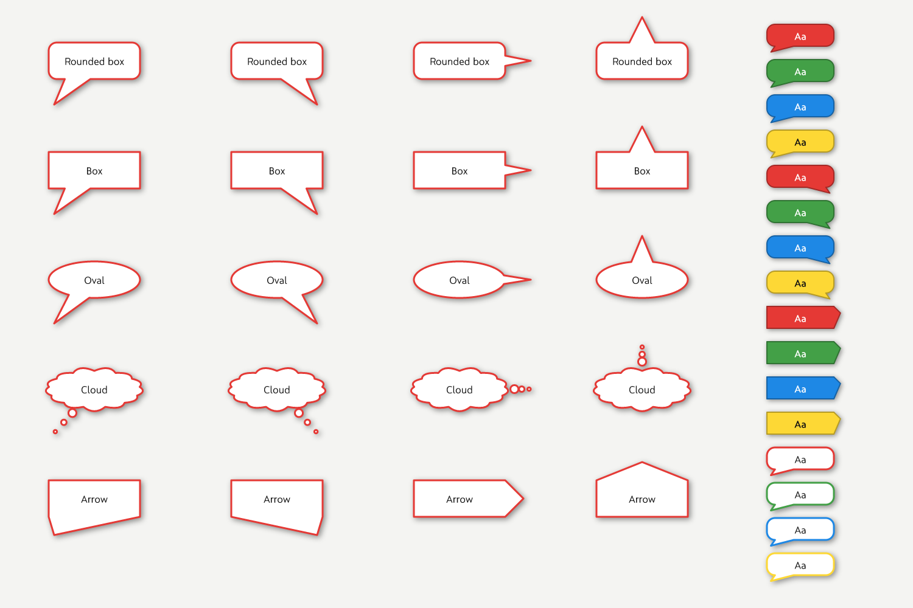

# The editor's tools, compared with Snagit's

Snagit's editor was observed black-box (from a labelled picture of its window); nothing of it is
copied beyond feature names. This page lists what its tool area has, what ScreenGrabCraft's editor
had before 0.1.19, and what is still missing.

## What Snagit's editor has

| Area | What's there |
|---|---|
| Tool bar, top centre | Favorites, Arrow, Text, Callout, Shape, Stamp, Fill, Move, then every other tool, each with its own button (ScreenGrabCraft shows them all rather than tuck some under More) |
| Quick Styles, right | a theme menu, then a grid of ready-made looks for the current tool (for callouts: four colours, tails to the lower left or right, arrow-shaped callouts); a look can be starred as a favourite |
| Tool properties, under it | fill colour, outline colour, a shape picker, a "more" grid, and two sliders with number boxes (thickness, opacity) |
| Under the panel | an Effects button and a Properties button |
| Elsewhere (not the focus here) | Library, Create, a red Capture button and New at the top left; Copy All and Share Link at the top right; a video trim bar; recent captures along the bottom |

## The gaps before 0.1.19

| Area | ScreenGrabCraft had | Gap |
|---|---|---|
| Tool bar | all 17 tools in one row after the file buttons, Rectangle and Ellipse as two tools, Select as "Select and move" | no Favorites, no single Shape tool, no Move, no More menu; the row was long and squeezed in a narrow window |
| Quick Styles | each tool remembered the last look it drew with | no ready-made looks, no themes, no favourites |
| Tool properties | a large palette of the main colour, a fill row, colours folded away, sliders for thickness and opacity, then the shape's options at the bottom | no compact fill / outline / shape / more buttons; no way to pick a callout's shape |
| Effects, Properties | Effects only in the menu bar; the properties always shown | no Effects or Properties buttons by the panel |
| Callouts | one form: a rounded box with a tail dragged anywhere | no square, oval, cloud or arrow-shaped callouts; no tails set to the lower left or right in one click |
| Arrows | four head layouts, thickness, dashes, shadow | (curved arrows and other head shapes: still missing) |
| Shapes | rectangle, rounded rectangle, ellipse | (triangles and free polygons: still missing) |
| Text | our own fonts, colours, a box behind the text | no outline round the letters, no ready-made overlays (titles, captions on a see-through box) |
| Stamps | seven stamps drawn in code | (a larger library and your own pictures as stamps: still missing) |
| Fill | fills an area of the picture, or a shape, with a colour | — |

## What 0.1.26 changes

- **Selection tool** (Q, a box of dashes on the tool bar): drag on the picture to select an area
  of the picture itself. Drag inside it to move that part (it comes out as a piece of its own,
  leaving the place it was see-through); Ctrl+C copies it, Ctrl+X cuts it, Delete makes it
  see-through, Crop to Selection keeps only it, Esc lets go, Ctrl+A selects all of the picture.
  The Move tool does the same when its rubber band catches no annotation.
- **Flatten**: Flatten Selected (Ctrl+Shift+F, or all when nothing is selected) and Flatten All,
  in the Edit menu, the panel and the right-click menu.
- **Right-click menu** on the picture: Undo and Redo; for an area, Copy, Cut, Delete, Crop to
  Selection; for annotations, Copy, Cut, Flatten, Edit Text, Duplicate, Delete, Bring to Front,
  Send to Back; then Paste, Copy Picture, Flatten All, Select All Annotations, Select an Area of
  the Picture, Zoom to Fit. A right-click picks the annotation under it first.
- **Copy and cut** with annotations selected take only those (on see-through, cut to what they
  cover; blur, pixelate, spotlight and magnify with the picture under them).
- **The tool bar in groups** with a faint line between them: Move, Selection, Crop; Arrow, Line,
  Text, Callout, Shape, Stamp, Step; Pen, Highlighter, Fill; Blur, Pixelate, Spotlight, Magnify.
- **Pen and highlighter strokes** are shown selected along themselves (a thin dashed line, a dot
  at each end) rather than by a box, keep their colour, and aren't selected once drawn.
- **Recent captures**: the mouse wheel goes back through every capture (thumbnails are made for
  those in view only); **All captures** shows every one bigger, newest first, under Today,
  Yesterday or its date, with its time and a search. Videos have a play mark.
- **Videos**: a play button and the time under the picture.

## What 0.1.21 changes

- **An eyedropper in every colour menu** (fill, border, text, text outline, line, ring, and the
  Fill tool's colour): "Pick from the picture", then a click on the picture takes the colour
  shown there, annotations included, for that colour. A swatch beside the pointer shows the
  colour under it; Esc or the right button puts the eyedropper away.
- **The pointer shows the tool**: over the picture the eyedropper and the Fill tool's pail are
  the pointer, their tip on the spot that's picked or filled, white with a dark edge so they show
  on any colour. Windows has no such pointers, so the editor draws them and hides its own.

## What 0.1.20 changes

- **Every tool is on the tool bar**, at full size: no More menu. A window too narrow for one row
  puts the tools on a row of their own under the file buttons and the zoom, never smaller.
- **A callout keeps its box while it's resized**: one just drawn (still empty) no longer vanishes
  when a handle is pulled, and typing goes on once the handle is let go. A callout left without
  text stays, as a shape; only an empty text box goes.

## What 0.1.19 changes

- **Tool bar**: the file buttons and undo at the left; Favorites, Arrow, Text, Callout, Shape,
  Stamp, Fill and Move in the middle; More (Line, Pen, Highlighter, Step, Blur, Pixelate,
  Spotlight, Magnify, Crop) after them; Copy and the zoom at the right. Every tool keeps its key.
  Shape draws a rectangle, a rounded rectangle or an ellipse, whichever is picked in its
  properties (R and O still pick the rectangle and the ellipse).
- **Quick Styles** at the top of the right panel: a theme menu (Bold, Soft, Vivid, Mono) and a grid
  of looks for the tool, each drawn by the real renderer. A click sets the tool's look and changes
  the selected annotations to it (one undo step, the `object.look` command). The star on a look
  adds it to Favorites, and the Favorites tool shows every starred look; picking one picks its tool
  too. "Add the current look" stars a look you made yourself.
- **Tool properties** under it: Fill, Outline (or Border, Ring…), Text colour, a shape picker
  (callout form, rectangle or ellipse, arrow heads, stamp, round spotlight) and More (shadow,
  dashes, text style), then sliders with number boxes. **Effects** and **Properties** buttons sit at
  the bottom of the panel; Properties folds the tool properties away.
- **Text overlays**: the Text tool's quick styles are plain text, text with an outline round its
  letters, text with a shadow, text on a filled box, on a see-through box, in a bordered box, and
  titles (big, outlined and shadowed; a title sets the text's size, the other looks keep it). The
  outline has its own colour and width in the tool properties, for text and callouts alike.
- **Callouts** come in five forms: rounded box, box, oval, cloud (its tail a trail of bubbles) and
  arrow (the box narrows to a point at its tail). Tails can be set to the lower left, lower right,
  left, right, up or down, and still be dragged anywhere.

